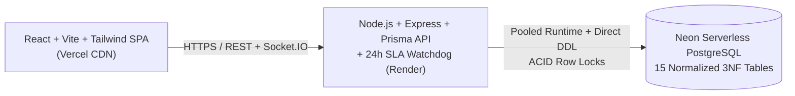

# EventKit — B2B Event Infrastructure, Quotation & Rental Lifecycle Platform

[](https://eventkit-wine.vercel.app)
[](https://eventkit-api.onrender.com/api/health)
[](https://www.typescriptlang.org/)

> **EventKit** replaces fragmented phone haggling, opaque vendor pricing, and double-booked paper registers with a structured B2B Request-for-Quotation (RFQ) marketplace, 3-way unbundled pricing, a Two-Phase 24-hour booking commit, and QR-verified delivery & return handover audits.

---

## Live Links

- **Web Application (Frontend):** https://eventkit-wine.vercel.app
- **REST API & WebSocket Health:** https://eventkit-api.onrender.com/api/health

*(Note: The API runs on Render's free tier; after 15 minutes of inactivity, the first request may take ~30–60 seconds to wake up.)*

---

## Why EventKit?

Local event infrastructure suppliers (tent houses, commercial catering equipment, sound/lighting rigs, and stage decorators) mostly operate offline. Organizers face four recurring failures:
1. **Low Discoverability:** Reliable local godowns have no searchable catalog or live stock status.
2. **Hidden Freight & Labor Fees:** Verbal quotes bundle or omit transport and setup crew costs until event day.
3. **Offline Double-Booking:** Sudden walk-in rentals cause last-minute event-day cancellations.
4. **Post-Event Damage Disputes:** Lack of pre-dispatch condition records turns broken or missing items into financial conflicts.

---

## Key Engineering Features

| Feature | How It Works |
|---|---|
| **Live GPS & 25 km Geofence Matching** | Detects live browser location (with locality fallback) and ranks verified local suppliers by Haversine distance (`<= 25 km`). |
| **3-Way Unbundled Quotations** | Every bid strictly separates **Base Equipment Rental**, **Truck & Freight Cost**, and **Setup/Dismantling Labor** (+ GST & deposit), compared side-by-side in a Comparison Matrix. |
| **10% Safety Buffer & Indicative Stock** | Caps online allocatable inventory at 90% of physical stock to cushion offline walk-ins, flagging status as *Ready to Book*, *Low Stock Left*, or *Check With Supplier* (>30 days stale). |
| **Two-Phase Commit (24h Soft-Hold)** | Accepting a quote executes an atomic PostgreSQL transaction (`SELECT ... FOR UPDATE`), auto-declines competing bids, and holds stock for 24 hours pending vendor confirmation. |
| **Autonomous 24h SLA Watchdog** | Background daemon sweeps expired quotes and unconfirmed holds every 60s (plus startup recovery), automatically restoring reserved stock and re-opening alternative quotes. |
| **Privacy-Gated Contact Masking** | Phone numbers, emails, and exact street addresses stay masked until a booking reaches `CONFIRMED`. |
| **QR-Verified Handover Manifests** | Generates HMAC-SHA256 QR passes and 4-digit PINs for Delivery and Return inspections with photo uploads; return discrepancies auto-escalate into immutable Admin dispute tickets. |
| **Vendor Reliability Index (VRI)** | Composite trust score (`40%` fulfillment + `30%` on-time dispatch + `20%` dispute-free ratio + `10%` verified client ratings). |

---

## System Architecture



### Repository Structure

```text
eventkit/
├── apps/
│   ├── api/                 # Express REST API, Socket.IO alerts, Watchdog daemon, Prisma schema & seed
│   └── web/                 # React + TypeScript + Tailwind SPA (Discovery, Organizer, Vendor, Admin)
├── packages/
│   └── shared/              # Shared Zod schemas, 3-way bid math, VRI formula, Haversine & masking helpers
├── render.yaml              # Render Web Service deployment blueprint
└── vercel.json              # Vercel monorepo build & SPA rewrite configuration
```

### Core 3NF Data Model (15 Tables)
`users` · `vendor_profiles` · `service_categories` · `service_listings` · `availability_blocks` · `event_requirements` · `requirement_items` · `quotations` · `quote_items` · `bookings` · `handover_checklists` · `reviews` · `support_tickets` · `messages` · `audit_logs` *(plus `notifications`)*

---

## Interactive Role Walkthrough

The live app includes a **Quick Role Switcher** at the top and a built-in **`How It Works (Guide)`** modal:

1. **Public Marketplace (`/`):** Browse verified Indore suppliers, detect live GPS distance, inspect 10% safety buffers, and verify that unverified suppliers are excluded.
2. **Event Planner (`Organizer`):** Compare competing bids side-by-side (`RFQ-2026-101`), ask for a lower price, dispatch a multi-category RFQ, or initiate a 24-hour Soft-Hold.
3. **Equipment Supplier (`Vendor`):** Manage warehouse SKUs, send split-up 3-way quotes, confirm urgent 24-hour holds (`BK-IN-90215`), and run QR Delivery/Return audits.
4. **Platform Admin (`Admin`):** Verify pending supplier GST/KYC profiles, arbitrate damage disputes, inspect the immutable Audit Trail, and test the 24-hour Watchdog expiry simulator.

---

## Tech Stack

- **Frontend:** React 18, TypeScript, Vite, Tailwind CSS, Lucide Icons, Socket.IO Client
- **Backend:** Node.js, Express, TypeScript, Prisma ORM, Zod, BCrypt, JWT, `qrcode`, Socket.IO
- **Database:** PostgreSQL (Neon Serverless)
- **Verification:** Node.js native test runner (`tsx --test`), TypeScript strict builds (`tsc`), live ACID & Watchdog smoke checks
